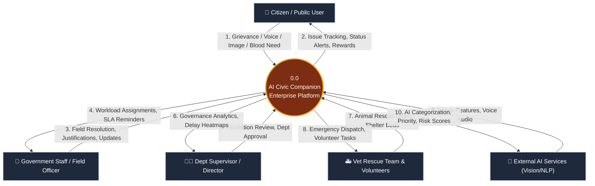
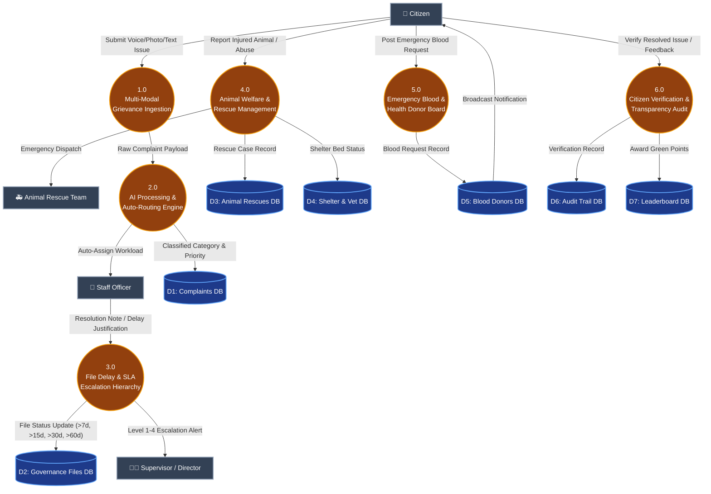
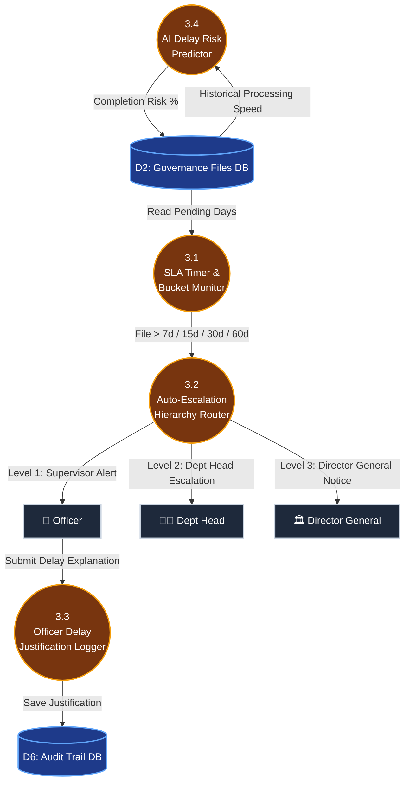
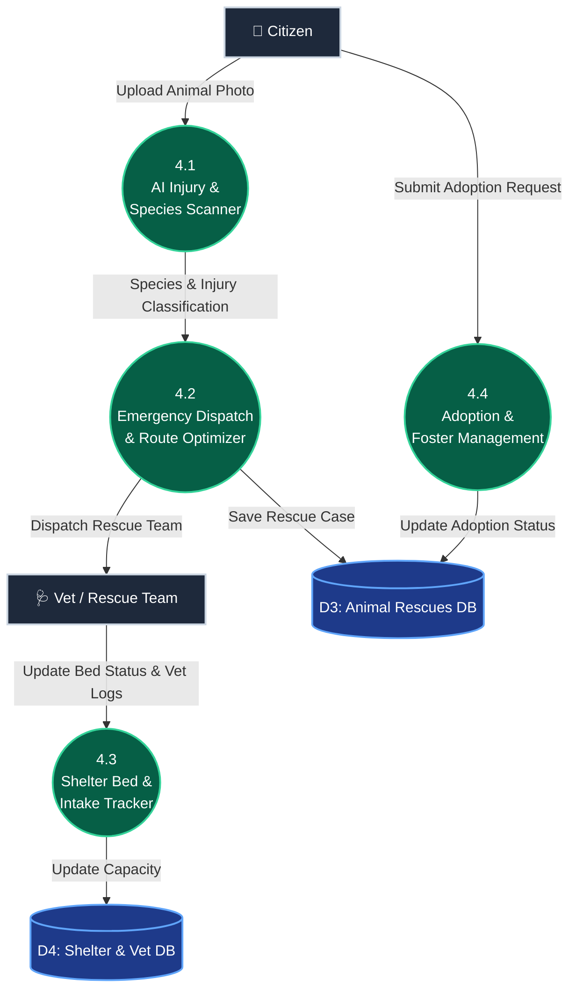

# AI Civic Companion - System Data Flow Diagram (DFD)

This document provides a comprehensive **Data Flow Diagram (DFD)** specification for the entire **AI Civic Companion** platform. It documents how data flows between External Entities, Core System Processes, AI Engines, Data Stores, and Governance Escalation Workflows.

---

## 🏛️ 1. Level 0 DFD: System Context Diagram

The **Level 0 DFD** represents the entire **AI Civic Companion** platform as a single process interacting with key external entities.

---

## 🔄 2. Level 1 DFD: Sub-System Process Breakdown

The **Level 1 DFD** decomposes the core system into **6 primary process modules** and maps their interactions with system Data Stores.

---

## 🔬 3. Level 2 DFD: Detailed Module Breakdown

### 3.1 Level 2 DFD - File Governance & SLA Escalation Hierarchy (Process 3.0)

---

### 3.2 Level 2 DFD - Animal Welfare & Rescue System (Process 4.0)

---

## 📋 4. Data Dictionary Specification

### 4.1 Data Stores (Database Repositories)

| Store ID | Name | Description | Key Attributes |
| :--- | :--- | :--- | :--- |
| **D1** | **Complaints DB** | Stores all registered civic complaints & grievances | `id`, `category`, `description`, `location`, `priority`, `status`, `reporterId`, `assignedOfficerId`, `createdAt` |
| **D2** | **Governance Files DB** | Tracks administrative file movement & SLA status | `fileId`, `title`, `department`, `officerScore`, `pendingDays`, `slaLimit`, `escalationLevel`, `aiDelayRisk` |
| **D3** | **Animal Rescues DB** | Stores animal rescue requests & case progress | `caseId`, `species`, `severity`, `location`, `rescueTeam`, `shelterId`, `pendingHours`, `status` |
| **D4** | **Shelter & Vet DB** | Manages shelter bed capacity, food, vet records | `shelterId`, `bedsTotal`, `bedsOccupied`, `vetOnDuty`, `inventoryStatus`, `quarantineAvailable` |
| **D5** | **Blood Donors DB** | Tracks urgent blood donor requests & opted-in donors | `requestId`, `requesterName`, `bloodGroup`, `hospital`, `urgency`, `contactPhone`, `status` |
| **D6** | **Audit Trail DB** | Maintains immutable logs of officer justifications & actions | `auditId`, `referenceId`, `actionType`, `actorUid`, `timestamp`, `justificationNotes` |
| **D7** | **Leaderboard DB** | Stores citizen rewards, green points & badges | `userId`, `points`, `badge`, `verifiedComplaintsCount` |

---

### 4.2 External Entities

| Entity Name | Description | Inputs Provided | Outputs Received |
| :--- | :--- | :--- | :--- |
| **Citizen / Public User** | Primary user filing civic complaints, tracking files, & adopting animals | Voice audio, photos, text complaints, delay complaints, blood requests | Issue status updates, AI transcriptions, ETA, green points |
| **Government Staff / Field Officer** | Field workers resolving assigned civic issues & updating file statuses | Issue resolution notes, photo evidence, delay justification notes | Assigned workload list, SLA warnings, performance scores |
| **Dept Supervisor / Director** | High-level officials reviewing escalated delays & department analytics | Re-assignment commands, approval/rejection of justifications | SLA violation alerts, delay heatmaps, officer scorecards |
| **Vet Rescue Team & Volunteers** | Emergency animal rescue responders & shelter staff | Rescue status updates, animal intake logs, medical records | Emergency dispatch alerts, optimal rescue routes, volunteer tasks |
| **External AI Engine** | Multi-modal AI microservice for NLP & Computer Vision | Raw audio bytes, complaint images, historical resolution times | Auto-categories, injury severity, priority score, delay prediction |

---

### 4.3 Key Process Descriptions

1. **Process 1.0 (Multi-Modal Grievance Ingestion)**: Converts citizen input (Voice in 10 Indian languages, Camera photos, Text) into structured payloads.
2. **Process 2.0 (AI Processing & Auto-Routing Engine)**: Runs computer vision for trash/pothole/injury detection, checks duplicate filings, and routes to nearest field officer.
3. **Process 3.0 (File Delay & SLA Escalation Hierarchy)**: Tracks file pending durations (>7d, >15d, >30d, >60d), triggers 4-level escalations, and logs officer justifications.
4. **Process 4.0 (Animal Welfare & Rescue Management)**: Manages emergency rescue dispatches, shelter bed capacities, veterinary care, adoption applications, and AI species scanning.
5. **Process 5.0 (Emergency Blood & Health Board)**: Manages urgent blood donor requests and broadcasts emergency alerts to matching local donors.
6. **Process 6.0 (Citizen Verification & Transparency Audit)**: Enables citizen 2-step verification of resolved issues, awards Green Points, and publishes resolution feeds.
